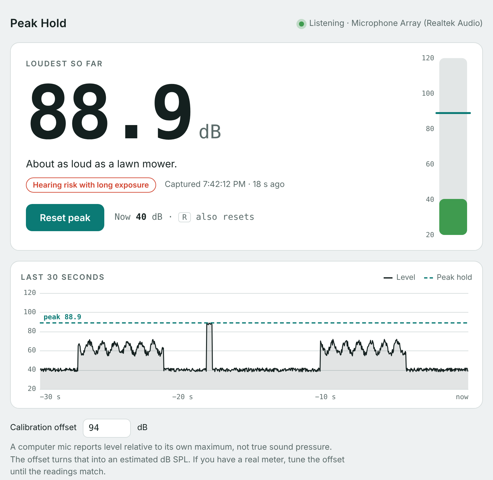

# Peak Hold

A desktop decibel meter for Windows and macOS. It listens to the default microphone, holds the loudest level it has heard, and keeps it until you reset it. It lives in the tray (Windows) or the menu bar (macOS), so closing the window keeps it measuring.

Built with [Tauri 2](https://tauri.app): the window is plain HTML, CSS and JS in `src/`; the microphone is read natively in Rust (`src-tauri/src/audio.rs`, through [cpal](https://github.com/RustAudio/cpal): WASAPI on Windows, Core Audio on macOS).

<picture>
  <source media="(prefers-color-scheme: dark)" srcset="docs/screenshot-dark.png">
  
</picture>

## What it shows

- **Loudest so far**: the peak, when it happened, and a rough comparison ("About as loud as a busy restaurant").
- **Live meter**: the current level, green, amber or red, with the peak marked.
- **Last 30 seconds**: a history graph with the peak hold line.
- **Tray / menu bar**: the tooltip shows the peak; on macOS the peak sits next to the icon. The menu has Show meter, Reset peak and Quit.

Reset with the button, the **R** key, or the tray menu.

## Accuracy

Readings are estimates. A computer mic reports level in dBFS (relative to its own maximum). The calibration offset in the window (default 94) turns that into estimated dB SPL. Tune it against a real meter. For true readings, use a calibrated measurement mic.

## Run it

You need Node.js and Rust ([rustup](https://rustup.rs)).

- **Windows**: also the Visual Studio Build Tools with the "Desktop development with C++" workload. WebView2 ships with Windows 11.
- **macOS**: also the Xcode command line tools (`xcode-select --install`).

```bash
npm install
npm run dev
```

The first run compiles all the Rust dependencies and takes a few minutes; later runs are fast.

Build an installer for the machine you're on:

```bash
npm run build
```

The installer lands in `src-tauri/target/release/bundle/` (`.msi` and `.exe` on Windows, `.app` and `.dmg` on macOS). Each OS builds its own; build the Mac version on a Mac.

## Microphone permission

- **Windows**: Settings › Privacy & security › Microphone › "Let desktop apps access your microphone" must be on.
- **macOS**: the first launch asks for the microphone. If you said no, allow it in System Settings › Privacy & Security › Microphone. When running with `npm run dev`, the permission goes to your terminal app.

## Icons

`app-icon.svg` is the source. After changing it, regenerate the icon set:

```bash
npx tauri icon app-icon.svg
```

## Screenshots

The images in `docs/` come from `scripts/screenshots.mjs`, which loads the window in a browser with made-up levels (no mic or Rust build needed). After changing the UI, run `npx -y playwright@1 install chromium` once, then `npm i --no-save playwright && node scripts/screenshots.mjs`.

## License

[MIT](LICENSE) © 2026 Antonio Rodríguez Martínez
